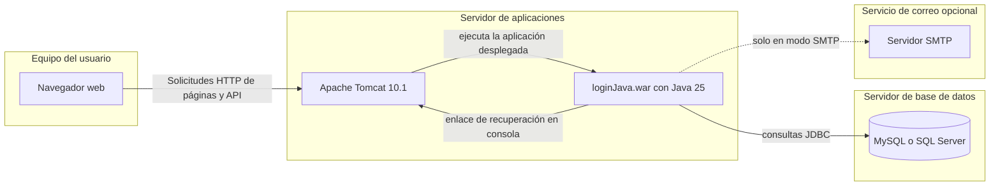
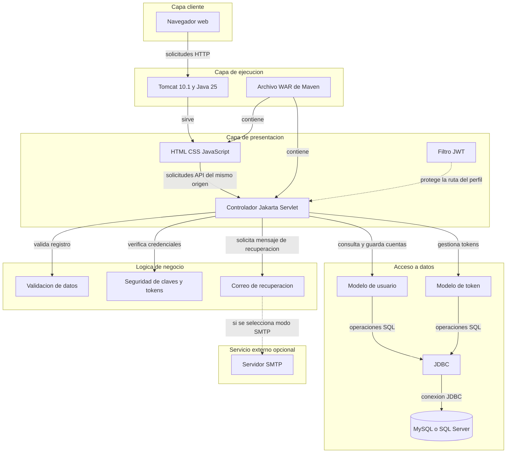
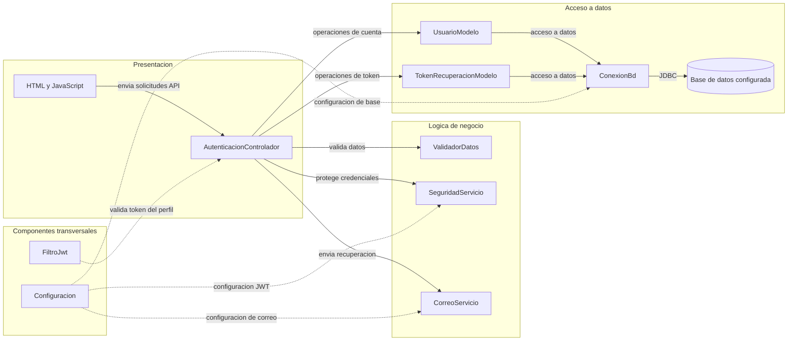

# Architecture Diagram

SIGA permite registrar usuarios, iniciar sesión, consultar el perfil y recuperar contraseñas. La interfaz web y la API Java se empaquetan juntas y usan una base de datos relacional.

## Diagrama de Despliegue

El archivo WAR se instala en un contenedor de servlets Java. La aplicación se conecta a MySQL o SQL Server; la recuperación de contraseña escribe el enlace en la consola de Tomcat por defecto o usa SMTP si se configura.

<!-- mermaid-checked: no \n, no em-dash/en-dash, no {} in labels, subgraphs are id["label"], arrows are -->|"label"|, all subgraphs closed by end, ids unique -->

## Application Architecture

Tomcat sirve la interfaz web desde el WAR. El JavaScript del navegador consume la API del mismo origen; la aplicación valida solicitudes, aplica reglas de cuentas y tokens, y accede a la base de datos mediante JDBC.

<!-- mermaid-checked: no \n, no em-dash/en-dash, no {} in labels, subgraphs are id["label"], arrows are -->|"label"|, all subgraphs closed by end, ids unique -->

### Technology Stack Summary

| Layer | Technology | Version | Purpose |
|---|---|---|---|
| Cliente | HTML, CSS, JavaScript | Nativo del navegador | Formularios e interfaz |
| Ejecucion web | Apache Tomcat | Objetivo 10.1 | Sirve paginas y ejecuta el WAR |
| Aplicacion | Java y Jakarta Servlet API | Java 25, Servlet 6.0 | API y logica de negocio |
| Construccion | Maven | Compiler plugin 3.13.0 | Compila y empaqueta el WAR |
| Acceso a datos | JDBC | MySQL Connector 9.1.0 o SQL Server JDBC 12.8.1 | Conexion con la base relacional |
| Base de datos | MySQL, MariaDB o SQL Server | MySQL 8, MariaDB 10.4+, SQL Server 2019 o 2022 | Cuentas y tokens de recuperacion |
| Seguridad | BCrypt y JJWT | BCrypt 0.10.2, JJWT 0.12.6 | Hash de claves y sesiones firmadas |
| Correo | Jakarta Mail con Angus | Angus Mail 2.0.3 | Correo de recuperacion por SMTP, opcional |

### Data Storage & External Services

La aplicacion almacena cuentas en `usuario` y tokens de recuperacion en `tokenRecuperacion`. Se configura una sola base relacional a la vez: MySQL o SQL Server. No hay cache ni intermediario de mensajes. Por defecto, los enlaces de recuperacion se imprimen en la consola de Tomcat; SMTP es opcional.

### Key Architectural Decisions

- La interfaz y la API se entregan desde un solo WAR de Maven y usan rutas relativas del mismo origen.
- Los servlets coordinan validacion, seguridad y modelos JDBC dentro de una aplicacion monolitica.
- Las variables de entorno pueden reemplazar la configuracion local de base de datos, JWT y correo.

## Component Relationships

El servlet coordina el registro, el inicio de sesion, el perfil y la recuperacion. El filtro JWT protege el perfil y los modelos centralizan las consultas mediante el helper JDBC.

<!-- mermaid-checked: no \n, no em-dash/en-dash, no {} in labels, subgraphs are id["label"], arrows are -->|"label"|, all subgraphs closed by end, ids unique -->

### Component Inventory

| Component | Layer | Type | Responsibility |
|---|---|---|---|
| HTML y JavaScript | Presentacion | Cliente web | Recoge datos, llama a la API y conserva el token de sesion |
| AutenticacionControlador | Presentacion | Servlet Jakarta | Dirige solicitudes de registro, login, perfil y recuperacion |
| ValidadorDatos | Logica de negocio | Validador | Comprueba datos de registro, correo, documento, rol y clave |
| SeguridadServicio | Logica de negocio | Servicio de seguridad | Genera hashes de clave, firma JWT y calcula hashes de tokens |
| CorreoServicio | Logica de negocio | Servicio de correo | Imprime enlaces en consola o los envia por SMTP |
| UsuarioModelo | Acceso a datos | Modelo | Consulta y actualiza cuentas |
| TokenRecuperacionModelo | Acceso a datos | Modelo | Crea, vence y consume tokens de recuperacion |
| ConexionBd | Acceso a datos | Helper JDBC | Abre conexiones y ejecuta SQL parametrizado |
| FiltroJwt | Transversal | Filtro servlet | Exige token bearer valido para la ruta del perfil |
| Configuracion | Transversal | Configuracion | Lee propiedades y variables de entorno |
