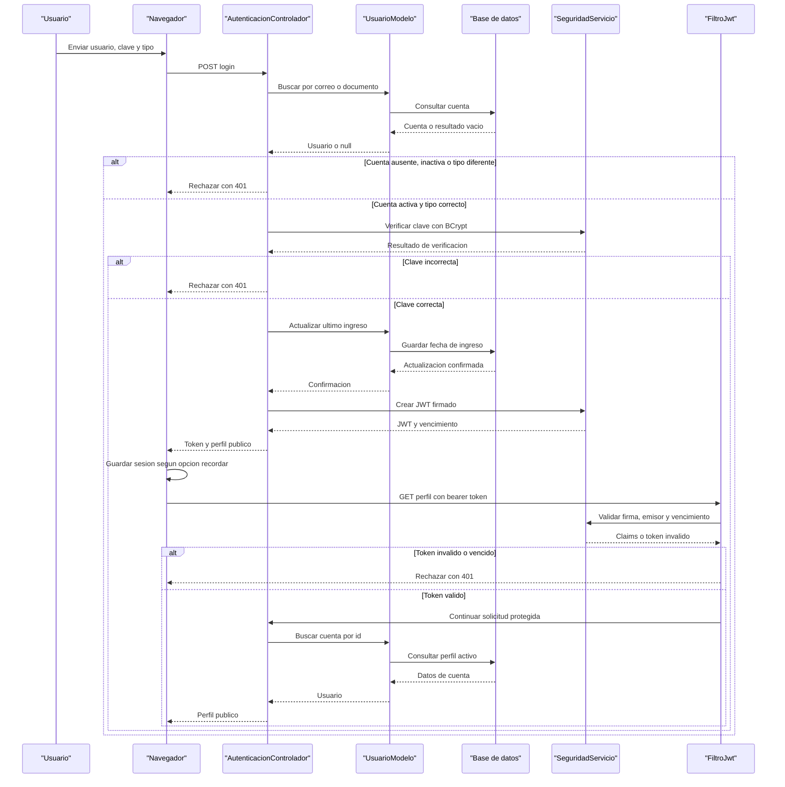

# Core Business Workflows

SIGA permite crear cuentas, iniciar sesion, consultar el perfil y recuperar el acceso cuando se olvida la clave. Las operaciones se realizan en una aplicacion Java conectada a una base de datos relacional.

## Domain Entities

| Entity | Service / Bounded Context | Description | Key Relationships |
|---|---|---|---|
| Usuario | Acceso a cuentas | Persona con cuenta SIGA, rol y estado activo o inactivo | Puede tener varios tokens de recuperacion |
| TokenRecuperacion | Recuperacion de cuenta | Credencial temporal y de un solo uso para cambiar una clave | Pertenece a un Usuario |

## Service-to-Domain Mapping

SIGA es un monolito; no tiene servicios de negocio desplegados por separado.

| Service | Domain Context | Owned Entities | External Dependencies |
|---|---|---|---|
| Aplicacion web Java SIGA | Acceso y recuperacion de cuentas | Usuario, TokenRecuperacion | MySQL o SQL Server; SMTP opcional |

La aplicacion Java es la fuente de verdad de ambas entidades. Los datos se guardan en la misma base configurada. El correo de recuperacion se envia por SMTP solo si se habilita; en caso contrario, el enlace se imprime en la consola de Tomcat.

## Primary Workflows

### Flujo 1: Registro de Cuenta

1. El navegador comprueba los campos requeridos y que se haya aceptado la casilla de terminos.
2. El servlet valida el tipo de usuario, nombre, documento, correo y clave, incluida la confirmacion.
3. La aplicacion verifica que el correo y el documento no esten registrados.
4. Si alguno ya existe, devuelve un conflicto. Si no, genera un hash BCrypt e inserta la cuenta como activa.
5. El navegador muestra el mensaje de bienvenida. El registro no inicia sesion automaticamente.

La base de datos tambien impone la unicidad del correo y documento. La casilla de terminos se valida solo en el navegador; el servidor no la recibe ni la valida actualmente.

### Flujo 2: Inicio de Sesion y Perfil

1. El usuario envia correo o documento, clave y tipo de usuario seleccionado.
2. El servidor busca la cuenta. Rechaza cuentas inexistentes o inactivas y tipos que no coinciden.
3. Comprueba la clave contra el hash BCrypt. Si es valida, actualiza la fecha del ultimo ingreso y devuelve un JWT firmado junto con datos publicos del perfil.
4. El navegador guarda el token en `sessionStorage` o `localStorage`, segun la opcion de recordar el dispositivo.
5. Al consultar el perfil, el filtro JWT valida el token bearer. Luego el controlador busca la cuenta activa y devuelve su perfil publico.

### Flujo 3: Recuperacion de Clave

1. El usuario envia un correo. La respuesta es la misma exista o no una cuenta con ese correo.
2. Para una cuenta activa, se invalidan tokens anteriores, se genera uno aleatorio y se guarda solo su hash SHA-256 con fecha de vencimiento. El enlace se envia o se imprime.
3. El usuario envia el token y una clave nueva con su confirmacion.
4. El servidor valida las reglas de clave, el hash, el vencimiento y el uso previo. Marca el token como usado antes de cambiar la clave.
5. La nueva clave se guarda como hash BCrypt.

## Cross-Service Data Flows

No hay agregacion entre servicios porque la aplicacion es monolitica. El controlador coordina modelos que consultan y actualizan la base compartida. La recuperacion puede enviar un mensaje a un servidor SMTP; en modo consola, el enlace aparece en la salida de Tomcat.

## Business Workflow Sequence

El diagrama muestra un inicio de sesion exitoso y la consulta posterior de una ruta protegida. Incluye los caminos de rechazo por credenciales y por token invalido o vencido.

<!-- mermaid-checked: every participant uses `participant Id as "Label"`, no \n in aliases/messages/notes, every alt/opt/loop closed by end, no `:` inside any alias -->

## Business Rules & Decision Logic

- Los roles permitidos son Administrador, Coordinador, Directivo, Secretario y Docente.
- El nombre debe tener entre 3 y 120 caracteres; el documento, entre 5 y 15 digitos; el correo debe tener formato valido y hasta 120 caracteres.
- La clave requiere minimo 8 caracteres, una mayuscula, una minuscula y un digito. Su longitud UTF-8 no puede superar 71 bytes y la confirmacion debe coincidir.
- Correo y documento son unicos. El inicio de sesion requiere una cuenta activa, el rol seleccionado y la clave correcta.
- El vencimiento JWT es configurable: se usan horas para una sesion normal y dias si se recuerda el dispositivo.
- Los enlaces de recuperacion vencen segun la configuracion y solo se pueden usar una vez. La base guarda el hash del token, no el token original.
- La respuesta de recuperacion no revela si el correo esta registrado.
- La casilla de terminos solo se comprueba en el navegador; no hay una validacion equivalente en el servidor.
